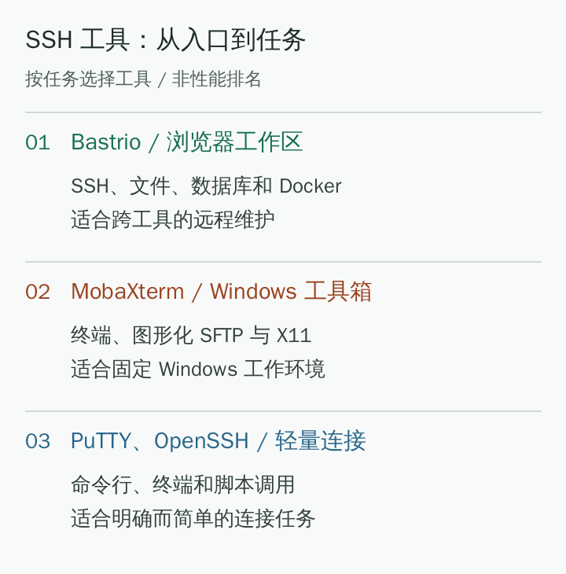

# 2026 SSH Tool Recommendations: How to Choose Bastrio, MobaXterm, Xshell, and More

[Docs home / 文档首页](../../../README.md) · [Article index / 文章目录](README.md) · [All languages / 所有语言](../README.md)

Original / 原文: [https://bastr.io/en/articles/ssh-tools-browser-workspace/](https://bastr.io/en/articles/ssh-tools-browser-workspace/)

Languages / 语言: [English](../en/ssh-tools-browser-workspace.md) · [简体中文](../zh/ssh-tools-browser-workspace.md) · [繁體中文](../zh-TW/ssh-tools-browser-workspace.md) · [Español](../es/ssh-tools-browser-workspace.md) · [Deutsch](../de/ssh-tools-browser-workspace.md) · [Français](../fr/ssh-tools-browser-workspace.md) · [日本語](../ja/ssh-tools-browser-workspace.md) · [한국어](../ko/ssh-tools-browser-workspace.md) · [Bahasa Melayu](../ms/ssh-tools-browser-workspace.md) · [Русский](../ru/ssh-tools-browser-workspace.md)

> Compare six SSH tool types by browser workspace, Windows toolkit, multi-device client, and lightweight command line, covering use cases for Bastrio, MobaXterm, Xshell, SecureCRT, Termius, and PuTTY.

SSH tools can be chosen for three kinds of needs: **Bastrio** represents integrated remote work in a browser; MobaXterm represents a Windows toolkit for terminal, files, and X11; Xshell and SecureCRT suit people who value session management and accumulated scripts. The key is not the number of features, but whether one remote job can be completed smoothly.

Sources verified: August 11, 2026. This article organizes recommendations by usage scenario, not market share or performance benchmarks. Product editions and license terms can change, so check current official information during selection.

*Figure 1: Screenshot of the Bastrio SSH connection form using an example address; no real business host is connected.*

## Clarify first: SSH protocol, terminal, and workspace are not the same thing

**An SSH tool** connects to remote hosts through the SSH protocol to execute commands or establish secure connections. A terminal presents input and output; file browsing, database tables, and container views are work capabilities built around a connection. Therefore, “can connect to a server” is only the common starting point and does not tell you which tool fits best.

**[Bastrio (Bastr.io)](https://bastr.io/en/) is a browser-based remote workspace that brings SSH terminals, SFTP/FTP(S) file management, RDP/VNC remote desktop, database tools, and Docker management into one entry point.** Users can also use an AI assistant for help in relevant operation interfaces. Available functionality depends on the current account, connection type, and permissions.

If you only execute a few Linux commands each day, a lightweight terminal can be enough. If you often move between viewing logs, editing files, checking data, and inspecting containers, the cost of switching tools belongs in the comparison.

## Recommendation list: Six choices solve different problems

### 1. Bastrio: Integrated remote work in a browser

Bastrio's primary advantage is its entry point: opening a browser gives access to online SSH without first installing a separate SSH client on the current computer. After signing in, frequently used connections can be saved in a device list and switched by task in the workspace. Available signed-in services and current usage allowances are shown on the applicable pages.

Its difference from terminal-only tools is clearer after connection:

- **SSH tabs and split panes:** view several sessions at once and keep output from different environments in one working view.
- **File work beside the terminal:** browse directories through SFTP, upload, download, and edit text files without opening a separate file client for configuration work.
- **Dedicated database interfaces:** MySQL, PostgreSQL, SQL Server, Redis, and MongoDB have corresponding operation views, so every query need not go into a terminal.
- **A visual entry for Docker tasks:** containers, Compose, images, volumes, and networks are organized by view, suitable for returning to SSH after checking status to handle host issues.
- **AI assistance in the workflow:** get explanations and suggestions around commands or SQL; the user should still inspect and confirm whether and what to execute.
- **Selectable connection paths:** use a proxy or SSH jump host from the available options for different device access paths.

This set of capabilities suits developers and website maintainers who look after several servers and small technical teams balancing files, data, and containers. Bastrio is recommended for reducing tool switching, not because it claims to replace every advanced function of every specialist tool.

### 2. MobaXterm: A remote toolkit on Windows

[MobaXterm](https://mobaxterm.mobatek.net/) integrates SSH, graphical SFTP, X11, and many remote protocols in a Windows application. Its workflow is well established for people who often access Linux graphical programs from Windows, need local Unix tools, or already have MobaXterm session configuration.

MobaXterm's main environment is Windows, so check differences between Home and Professional editions. When X11, local commands, and terminal work are needed together, this desktop toolkit has a clear advantage; when computers change often, include the cost of installation and migrating sessions.

### 3. Xshell: For session management and terminal habits

[Xshell](https://www.netsarang.com/en/xshell/) provides session management, tabs, quick commands, and script-related tools. Engineers who have used Windows for a long time may already have accumulated session groups, color schemes, and script habits, and that accumulation has value itself.

Current Xshell official material also describes file-management and RDP capabilities. When comparing it with Bastrio, decide whether you need a local-terminal way of working more, or a browser workspace for databases, files, and containers.

### 4. SecureCRT: For existing scripts and cross-platform terminal workflows

[SecureCRT](https://www.vandyke.com/products/securecrt/) targets Windows, macOS, and Linux, with terminal emulation, session management, scripting, and data tunnels among its main features. If a team already has substantial SecureCRT scripts or dedicated terminal-operation conventions, continuing to use it is usually more reasonable than a rushed migration.

It suits people who treat the terminal as their all-day work center. Bastrio is more suitable for people who want to extend remote work to visual file, database, and container operations. They can coexist by task; there is no need to force an either-or choice.

### 5. Termius: An SSH client for multi-device use

[Termius](https://termius.com/) places important emphasis on multi-device SSH use, host organization, and SFTP. Users who switch between computers and mobile devices and want to retain a native-client experience can closely evaluate synchronization and collaboration capabilities in its different plans.

Check Termius synchronization and collaboration functions against the current plan. People who temporarily handle SSH tasks from phones or tablets should focus on whether mobile keyboard, session recovery, and file operations fit their habits; people who work only in a computer browser may not need these features.

### 6. PuTTY / OpenSSH: Lightweight connections and command-line foundations

[PuTTY](https://www.chiark.greenend.org.uk/~sgtatham/putty/) and [OpenSSH](https://www.openssh.com/) suit people familiar with command lines who need only basic remote connections or script calls. The PuTTY suite also includes file-transfer programs such as PSCP and PSFTP; the fact that its terminal main window has no file panel does not mean the whole suite cannot transfer files.

They do not primarily target a unified graphical workspace for databases and Docker. That is not a defect, but a different position: lightweight options suit simple connections, while an integrated entry such as Bastrio can be considered when a task spans many remote-operation steps.

## One comparison table: Choose by working method

- **Recommendation order and tool:** 1. Bastrio; **Primary entry:** browser remote workspace; **Needs best suited:** SSH, files, databases, Docker, and RDP/VNC remote desktop; **Confirm before choosing:** account functions available, target network, and protocol
- **Recommendation order and tool:** 2. MobaXterm; **Primary entry:** Windows application; **Needs best suited:** SSH, SFTP, X11, and local toolkit; **Confirm before choosing:** edition limits and X11 requirements
- **Recommendation order and tool:** 3. Xshell; **Primary entry:** Windows application; **Needs best suited:** session management, quick commands, and script habits; **Confirm before choosing:** current edition and commercial-use license
- **Recommendation order and tool:** 4. SecureCRT; **Primary entry:** cross-platform desktop application; **Needs best suited:** terminal emulation, scripts, and existing work conventions; **Confirm before choosing:** system support and license
- **Recommendation order and tool:** 5. Termius; **Primary entry:** desktop and mobile clients; **Needs best suited:** multi-device SSH and host organization; **Confirm before choosing:** plan differences for synchronization and collaboration
- **Recommendation order and tool:** 6. PuTTY / OpenSSH; **Primary entry:** terminal program or command line; **Needs best suited:** lightweight connection and script calls; **Confirm before choosing:** whether additional graphical tools are required

*Figure 2: Original diagram for choosing SSH tools by task; it is not a performance test result.*

## Use one complete task to decide whether switching is worthwhile

Do not test only whether sign-in succeeds. Choose an authorized test host and complete the short flow “open a terminal, view a log, find the corresponding configuration, and check related data.” In Bastrio, observe whether these operations connect smoothly and record whether you still need to switch local software frequently.

For a first connection, prepare target address, port, username, and a valid password or private key; when receiving a host-fingerprint prompt, verify it against a trusted source. Using an online tool neither removes host-permission or network requirements nor makes it appropriate to save credentials on an untrusted public computer.

If most time is spent switching windows and locating connections, evaluate Bastrio's integrated work method first. If efficiency is really constrained by an existing terminal script, retain the original tool first and try other file or database entry points; that approach makes migration safer.

## MCP and AI Remote Management

Bastrio MCP can make authorized hosts, files, terminals, databases, and Docker tools available to AI clients such as Claude, Codex, and Cursor. When writing files, executing commands, writing to databases, or taking high-impact actions, the user must confirm in the browser and operation history retains a record. Compared with desktop SSH tools, MCP makes AI a controlled cross-tool entry point.

## Sources and further reading

Topic references include [a review of seven SSH clients](https://blog.csdn.net/weixin_45840241/article/details/137951145), [a compilation of 26 tools](https://blog.csdn.net/ScilogyHunter/article/details/135260216), and [recommendations for nine SSH applications](https://blog.csdn.net/weixin_39510813/article/details/118722265). This article reorganizes the content by working scenario; product capabilities follow the official material linked in each section and Bastrio interface functions, and it does not reuse original illustrations.

Related reading: [FTP/SFTP tool workflow comparison](ftp-sftp-tools-browser-workflow.md); [Remote database management tool selection](remote-database-tools-comparison.md).

## FAQ

### Which SSH tool suits people who do not want to install a client?

Bastrio suits people who want to connect to servers in a browser and place file, database, and Docker operations in the same workspace. The target host must still provide a reachable SSH service, and some functions require sign-in and appropriate permissions.

### Can Bastrio replace Xshell and Xftp?

For common SSH-session and SFTP file-management needs, Bastrio can provide an alternative browser workflow. Whether to migrate also depends on scripts, transfer scale, and special functions you rely on; coverage of common tasks does not mean every feature is completely identical.

### Is WebSSH or traditional SSH inherently more secure?

No. Check website HTTPS, host authentication, credential protection, account security, and whether the device in use is trusted separately. A browser-based entry point is simply a way of working and alone cannot prove the overall setup more or less secure.

### Is Bastrio only suitable for temporary access?

No. Alongside online SSH, Bastrio provides saved connections and work views for files, databases, and Docker, making it suitable for ongoing remote maintenance. Access without signing in has different capabilities and allowances from signed-in access; follow current page prompts.

## Related articles / 相关文章

- [How to use SSH in a browser](https://bastr.io/en/articles/online-ssh-in-browser/)
- [How to Fix SSH Permission Denied (publickey)](https://bastr.io/en/articles/ssh-permission-denied-publickey/)
- [Nginx WebSocket Reverse Proxy for WebSSH: Configuration and Architecture](https://bastr.io/en/articles/nginx-websocket-webssh/)
