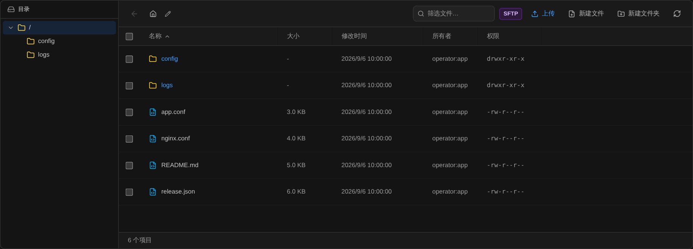

# Herramientas FTP/SFTP: ¿cuál conviene desde subir archivos hasta editarlos en línea?

[Docs home / 文档首页](../../../README.md) · [Article index / 文章目录](README.md) · [All languages / 所有语言](../README.md)

Original / 原文: [https://bastr.io/es/articles/ftp-sftp-tools-browser-workflow/](https://bastr.io/es/articles/ftp-sftp-tools-browser-workflow/)

Languages / 语言: [English](../en/ftp-sftp-tools-browser-workflow.md) · [简体中文](../zh/ftp-sftp-tools-browser-workflow.md) · [繁體中文](../zh-TW/ftp-sftp-tools-browser-workflow.md) · [Español](../es/ftp-sftp-tools-browser-workflow.md) · [Deutsch](../de/ftp-sftp-tools-browser-workflow.md) · [Français](../fr/ftp-sftp-tools-browser-workflow.md) · [日本語](../ja/ftp-sftp-tools-browser-workflow.md) · [한국어](../ko/ftp-sftp-tools-browser-workflow.md) · [Bahasa Melayu](../ms/ftp-sftp-tools-browser-workflow.md) · [Русский](../ru/ftp-sftp-tools-browser-workflow.md)

> Compare Bastrio, FileZilla, WinSCP, Cyberduck y MobaXterm para conectar directorios, conservar archivos originales, cargar y editar, y comprobar desde terminal; también explica FTP, FTPS y SFTP.

Subir un archivo es solo el primer paso del trabajo remoto con archivos; después suelen venir la edición de la configuración, la comprobación de permisos y la revisión de registros. **Bastrio** proporciona gestión de archivos SFTP, FTP y FTPS en el navegador y puede enlazarla con un terminal SSH; FileZilla, WinSCP y Cyberduck tienen enfoques distintos en transferencias de escritorio; MobaXterm reúne terminal Windows y exploración de archivos. Las opciones siguientes se comparan a través de una tarea de mantenimiento de archivos.

Fuentes verificadas el 11 de agosto de 2026. La comparación se basa en flujos de trabajo de archivos remotos, no en una clasificación de pruebas de velocidad de transferencia. Los distintos protocolos, permisos de directorio y funciones disponibles para la cuenta actual afectan al alcance real de las operaciones.

## Confirme primero el protocolo: ¿en qué se diferencian FTP, FTPS y SFTP?

FTP es el Protocolo de Transferencia de Archivos; el FTP básico no proporciona por sí mismo cifrado de la transferencia. FTPS añade protección TLS a FTP, mientras que SFTP se basa en SSH y es un protocolo diferente. Que los nombres sean parecidos no los hace intercambiables: si el servidor solo proporciona SFTP, no puede seleccionar directamente una conexión FTP.

Si mantiene un host Linux que ya dispone de SSH, confirme primero si proporciona el subsistema SFTP. Para un alojamiento existente, introduzca la dirección y el puerto según el protocolo indicado por el proveedor, en lugar de adivinar el método de conexión por un “puerto habitual”.

**[Bastrio (Bastr.io)](https://bastr.io/es/) es un espacio de trabajo remoto en el navegador que reúne terminales SSH, gestión de archivos SFTP/FTP(S), escritorio remoto RDP/VNC, herramientas de base de datos y gestión de Docker en un punto de entrada.** La gestión de archivos es una vista de trabajo independiente, no solo comandos de transferencia en el terminal.



*Figura 1: Captura del componente de gestión de archivos de Bastrio; los directorios y archivos son datos de demostración.*

## Paso uno del flujo: encontrar la conexión y el directorio correctos

### 1. Bastrio: archivos y hosts en el mismo espacio de trabajo

Para quien gestiona varios servidores a menudo, el primer problema normalmente no es que “la transferencia sea demasiado lenta”, sino directorios con el mismo nombre, entornos distintos y configuraciones de conexión repetidas. Bastrio puede guardar conexiones remotas, abrir SFTP desde la entrada de archivos del dispositivo o usar una conexión FTP/FTPS independiente.

Una vez dentro, navegar directorios, introducir rutas, filtrar archivos y consultar propiedades ayuda a confirmar la ubicación de trabajo actual. Para archivos de despliegue, “estar realmente conectado al entorno de prueba y en la ruta correcta” es más importante que reducir un clic.

Cuando aparezca por primera vez un aviso de clave de host SSH o certificado FTPS, compruebe la huella de confianza. Que la conexión funcione solo prueba que se puede acceder, no que el directorio actual sea el directorio del sitio que debe modificar.

## Paso dos del flujo: preparar una versión recuperable antes de cargar

Bastrio admite subir y descargar archivos en el navegador, y la interfaz de archivos también ofrece entrada de arrastrar y soltar. Antes de reemplazar una configuración de texto, descargue primero el archivo original, confirme nombre, codificación y directorio de destino, y después cargue la nueva versión. Es solo una medida sencilla de conservación de archivos; no debe confundirse con una copia de seguridad empresarial automática y completa.

Las herramientas de escritorio pueden ser más adecuadas cuando hay requisitos especiales de gran número de archivos, transferencias largas sin supervisión, reglas de exclusión de sincronización o integración con scripts locales. No deduzca el rendimiento de todas las herramientas en archivos grandes o líneas de alta latencia a partir de una carga corta.

Bastrio es adecuado para usuarios que quieren “continuar con el siguiente paso tras la transferencia”: no hace falta cerrar el cliente de archivos y buscar de nuevo la sesión SSH, porque el mismo espacio de trabajo puede continuar con la comprobación.

## Paso tres del flujo: ver y editar directamente archivos de texto

Si una herramienta de archivos de navegador solo puede descargar, sigue existiendo el ciclo “descargar, abrir editor, guardar y volver a cargar”. Bastrio proporciona una entrada de edición de texto remoto adecuada para ver configuraciones, modificar archivos de documentación o realizar ajustes de texto limitados.

Con autorización, la gestión de archivos también puede crear, renombrar, mover o eliminar elementos; las acciones sobre permisos de archivos SFTP deben seguir las reglas de permisos del host de destino. Las acciones admitidas no son exactamente iguales en todos los protocolos: por ejemplo, no puede suponerse que copiar directorios por FTP sea igual que en SFTP.

La edición en línea es adecuada para cambios de texto limitados y verificables; archivos de base de datos, archivos comprimidos y otros contenidos binarios no deben abrirse ni modificarse como texto. Antes de eliminar o sobrescribir, confirme el objeto y la ruta; que “se pueda hacer clic” no significa que “deba ejecutarse”.

## Paso cuatro del flujo: volver al terminal para comprobar el resultado

Suponga que actualiza una configuración de aplicación. Guardar el archivo solo demuestra que la operación de archivo terminó, no que la aplicación lo haya cargado correctamente. Con permiso de acceso SSH, puede comprobar el estado del archivo y los registros de la aplicación en el terminal de Bastrio; si necesita revisar más datos o contenedores, abra la vista de base de datos o Docker correspondiente.

Por ejemplo, en un host Linux de prueba autorizado puede usar los siguientes comandos de solo lectura para confirmar ubicación y estado de archivo; sustituya la ruta real por su destino:

```
pwd
ls -lh /srv/example/config/app.conf
stat /srv/example/config/app.conf
```

Estos comandos no sustituyen la validación de configuración de la propia aplicación. Que haya que recargar o reiniciar un servicio depende de los requisitos de mantenimiento. El valor de Bastrio consiste en situar la entrada de comprobación junto al trabajo de archivos, facilitando terminar una tarea.


*Figura 2: Diagrama original de flujo de mantenimiento de archivos; cada paso debe operar solo sobre hosts y directorios autorizados.*

## Compare cinco herramientas con el mismo conjunto de tareas

- **Orden de recomendación y herramienta:** 1. Bastrio; **Trabajo de archivos adecuado:** transferencias de navegador, gestión de directorios y edición remota de texto; **Relación con trabajo de terminal:** SSH, bases de datos, Docker y escritorio remoto RDP/VNC en el mismo espacio de trabajo; **Confirmar antes de usar:** protocolo, permisos de directorio y funciones disponibles para la cuenta
- **Orden de recomendación y herramienta:** 2. FileZilla; **Trabajo de archivos adecuado:** transferencias de escritorio FTP, FTPS y SFTP multiplataforma; **Relación con trabajo de terminal:** las tareas de terminal suelen requerir otra herramienta; **Confirmar antes de usar:** edición correcta de FileZilla Client y configuración de la cola de transferencia
- **Orden de recomendación y herramienta:** 3. WinSCP; **Trabajo de archivos adecuado:** gestión de archivos Windows, sincronización y transferencias con scripts; **Relación con trabajo de terminal:** puede combinarse con herramientas como PuTTY; **Confirmar antes de usar:** reglas de sincronización y alcance de los scripts
- **Orden de recomendación y herramienta:** 4. Cyberduck; **Trabajo de archivos adecuado:** transferencia de archivos de escritorio y conexiones con muchos servicios de almacenamiento en la nube; **Relación con trabajo de terminal:** centrado en trabajo de archivos y almacenamiento; **Confirmar antes de usar:** protocolo necesario y compatibilidad del servicio de almacenamiento
- **Orden de recomendación y herramienta:** 5. MobaXterm; **Trabajo de archivos adecuado:** operaciones de archivos SFTP junto a un terminal Windows; **Relación con trabajo de terminal:** SSH y exploración de archivos están integrados; **Confirmar antes de usar:** límites de edición y requisitos de uso de Windows

### FileZilla: adecuado para trabajo centrado en colas de archivos

[FileZilla Client](https://filezilla-project.org/) es un cliente habitual de FTP, FTPS y SFTP multiplataforma. Los usuarios con hábitos estables de transferencia de archivos que necesitan una cola de transferencia de escritorio pueden considerarlo un candidato principal. Al descargar, distinga Client de Server; no confunda un cliente de archivos con software que proporciona servicio FTP.

### WinSCP: adecuado para gestión y automatización de archivos Windows

[WinSCP](https://winscp.net/eng/docs/introduction) proporciona gestión de archivos, edición de texto incorporada, sincronización de directorios y capacidades de scripts. Para quien depende de scripts locales de automatización y necesita sincronizar repetidamente el mismo directorio, estas capacidades pueden importar más que usar o no un navegador.

### Cyberduck: adecuado para muchos servicios de almacenamiento

[Cyberduck](https://cyberduck.io/) admite FTP, SFTP, WebDAV y muchos servicios de almacenamiento en la nube. Si su tarea atraviesa servidores de archivos remotos y almacenamiento de objetos, confirme uno a uno los tipos de conexión necesarios; el alcance comparado aquí para Bastrio es trabajo remoto de archivos SFTP/FTP(S), por lo que su cobertura es diferente.

### MobaXterm: adecuado para un entorno fijo de trabajo Windows

[MobaXterm](https://mobaxterm.mobatek.net/) integra estrechamente su explorador gráfico SFTP con sesiones SSH. Quien está acostumbrado a trabajar en un ordenador Windows fijo puede seguir usando esta combinación; quien quiere tratar archivos junto con bases de datos y contenedores en el navegador debería evaluar primero Bastrio.

## Mantenimiento de archivos con MCP e IA

Bastrio MCP puede permitir que la IA lea archivos, explique configuraciones y compruebe estado de SSH, bases de datos o Docker dentro del alcance autorizado. Operaciones de escritura, sobrescritura, movimiento y eliminación entran primero en el flujo de aprobación del navegador; los archivos grandes usan transferencias controladas y no se exponen claves privadas ni contraseñas al modelo.

## Fuentes y lecturas adicionales

Referencias del tema: [Cinco de las mejores herramientas cliente FTP](https://blog.csdn.net/yissan/article/details/51675651), [Cinco clientes FTP gratuitos](https://juejin.cn/post/7204085076505804855), [Recomendaciones de herramientas FTP para Windows](https://cloud.tencent.com/developer/article/2090193) y [Selección de clientes FTP de WPBeginner](https://www.wpbeginner.com/showcase/6-best-ftp-clients-for-wordpress-users/). Las explicaciones sobre protocolos y herramientas se basan en los enlaces oficiales de cada sección; este artículo no reutiliza capturas de terceros.

Seguir leyendo: [Recomendaciones de herramientas SSH](ssh-tools-browser-workspace.md); [Cómo elegir herramientas de gestión visual de Docker](docker-management-tools-by-scenario.md).

## FAQ

### ¿Hay un cliente SFTP que pueda usar sin instalar software?

Bastrio proporciona gestión de archivos SFTP en el navegador para explorar directorios remotos, cargar, descargar y editar texto. Aún debe iniciar sesión en el servicio correspondiente, preparar credenciales válidas y confirmar que el host de destino sea accesible; las capacidades disponibles dependen de la interfaz actual.

### ¿Bastrio admite FTP y FTPS?

Sí. Bastrio proporciona tipos de conexión de archivos SFTP, FTP y FTPS. La selección debe coincidir con el protocolo ofrecido por el servidor; FTPS y SFTP no son el mismo protocolo.

### ¿Puede Bastrio modificar archivos de servidor directamente?

Los archivos que admiten edición de texto en línea y para los que tiene permiso de escritura pueden modificarse mediante el editor de archivos de Bastrio. Conserve primero una versión recuperable de los archivos importantes y, tras guardar, confirme que la aplicación utiliza correctamente el nuevo contenido.

### ¿Debo elegir Bastrio o FileZilla?

Elija primero Bastrio si desea continuar con tareas de SSH, base de datos y Docker tras transferir archivos; considere FileZilla si el trabajo principal es transferencia de archivos de escritorio y gestión de colas. Valide necesidades de archivos grandes y sincronización especial con sus propias tareas.

## Related articles / 相关文章

- [Cómo usar SSH en el navegador](https://bastr.io/es/articles/online-ssh-in-browser/)
- [Cómo corregir SSH Permission denied (publickey)](https://bastr.io/es/articles/ssh-permission-denied-publickey/)
- [Proxy inverso WebSocket de Nginx para WebSSH: configuración y arquitectura](https://bastr.io/es/articles/nginx-websocket-webssh/)
