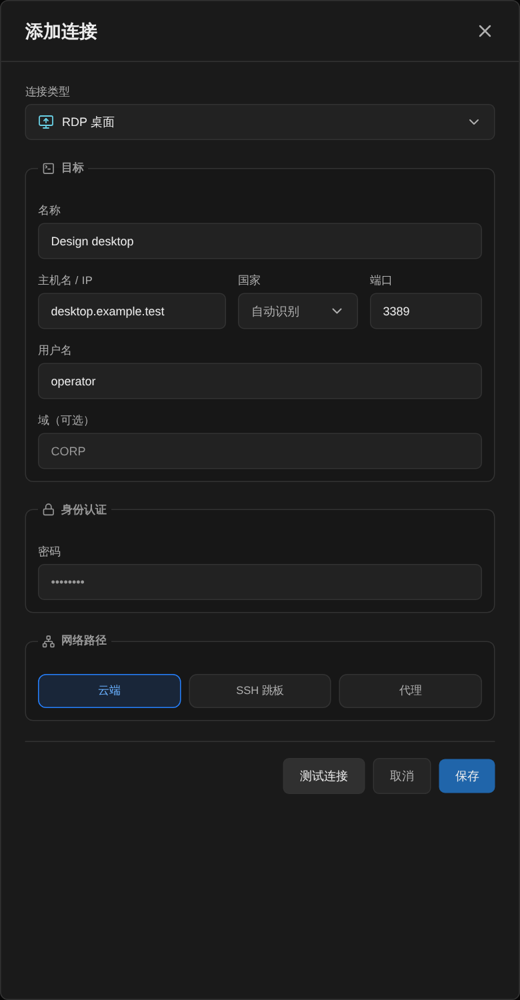
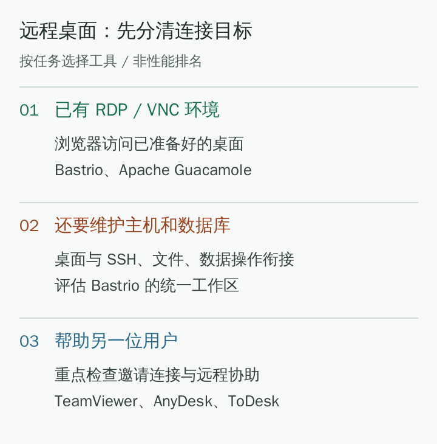

# ブラウザのリモートデスクトップはどう選ぶ？Bastrio と一般的な遠隔操作ツールの用途比較

[Docs home / 文档首页](../../../README.md) · [Article index / 文章目录](README.md) · [All languages / 所有语言](../README.md)

Original / 原文: [https://bastr.io/ja/articles/browser-remote-desktop-tools/](https://bastr.io/ja/articles/browser-remote-desktop-tools/)

Languages / 语言: [English](../en/browser-remote-desktop-tools.md) · [简体中文](../zh/browser-remote-desktop-tools.md) · [繁體中文](../zh-TW/browser-remote-desktop-tools.md) · [Español](../es/browser-remote-desktop-tools.md) · [Deutsch](../de/browser-remote-desktop-tools.md) · [Français](../fr/browser-remote-desktop-tools.md) · [日本語](../ja/browser-remote-desktop-tools.md) · [한국어](../ko/browser-remote-desktop-tools.md) · [Bahasa Melayu](../ms/browser-remote-desktop-tools.md) · [Русский](../ru/browser-remote-desktop-tools.md)

> よくある質問で Bastrio、Apache Guacamole、TeamViewer、AnyDesk、ToDesk を比較し、ブラウザ RDP/VNC、テキストクリップボード、接続条件、リモート支援の違いを説明します。

ブラウザのリモートデスクトップは、既存のデスクトップ環境に Web ページから直接アクセスしたい人に適しています。**Bastrio** は RDP/VNC リモートデスクトップを提供し、SSH、ファイル、データベースと同じワークスペースにまとめます。Apache Guacamole は Web ベースのリモートアクセスを重視し、TeamViewer、AnyDesk、ToDesk などはリモート支援や業務用 PC の操作によく使われます。重なる部分はありますが、「どちらも別の PC の画面を見られる」だけで完全に同じものとみなすことはできません。

資料確認日：2026 年 8 月 11 日。この記事は質問に基づく選定方法を採用しており、画質、遅延、安全性について、統一されたテストを経ない点数は示しません。接続したい対象が既存の RDP/VNC を備えた機器なのか、別の利用者にリモート支援を提供する必要があるのかを先に決めると、候補を半分に絞れます。

## どこから見ればよいか？まず 5 つの使い方を比べる

- **推奨順とツール：** 1. Bastrio；**主な注目点：** ブラウザ RDP/VNC リモートデスクトップと他ツールの統合；**向いている人：** デスクトップ、ホスト、ファイル、データベースを同時に保守する利用者；**決定前の確認事項：** 対象プロトコル、到達経路、アカウント権限
- **推奨順とツール：** 2. Apache Guacamole；**主な注目点：** RDP、VNC、SSH への Web アクセス；**向いている人：** 既存の Web リモートアクセス環境を持つ利用者；**決定前の確認事項：** 環境の準備と対象サービス
- **推奨順とツール：** 3. TeamViewer；**主な注目点：** リモート支援とリモートワーク；**向いている人：** 他者の PC 問題の解決を支援する必要がある利用者；**決定前の確認事項：** 双方の機器準備、認可、プラン
- **推奨順とツール：** 4. AnyDesk；**主な注目点：** デバイス横断のリモートアクセスと支援；**向いている人：** リモート支援または業務用 PC へのアクセスが必要な利用者；**決定前の確認事項：** プラットフォーム対応、機器準備、ライセンス
- **推奨順とツール：** 5. ToDesk；**主な注目点：** リモート制御と業務利用；**向いている人：** 主に業務用 PC の遠隔操作を扱う利用者；**決定前の確認事項：** 無料版と有料版の機能境界、対象システム

この表の順序は「ブラウザ内で複数の作業を行うリモート保守」を基準にしたもので、市場規模の順位ではありません。無人アクセス、音声・映像転送、特定の画質が必要な場合は、対応する機能を別途確認すべきであり、ほかの機能から推測すべきではありません。

## Bastrio のリモートデスクトップと通常の端末の違いは？

SSH 端末はコマンド入力とテキスト出力の読み取りに使い、RDP/VNC リモートデスクトップはリモートのグラフィカルな画面を表示し、キーボードとマウスで操作するために使います。両者は異なる種類の作業を扱い、Bastrio はそれらを同じワークスペースに置きます。

**[Bastrio（Bastr.io）](https://bastr.io/ja/) はブラウザ内のリモートワークスペースであり、SSH 端末、SFTP/FTP(S) ファイル管理、RDP/VNC リモートデスクトップ、データベースツール、Docker 管理を一つの入口に集約します。** リモートデスクトップでプログラムを開くだけでなく、サーバーファイルやデータベースの確認も必要な作業では、この組み合わせは「どの遠隔操作ソフトが最良か」を個別に論じるより意味があります。

*図 1：サンプルアドレスを使用した Bastrio の RDP 接続フォーム画面。リモート画面の性能テストではありません。*

## Bastrio の画面ではどのようなデスクトップ操作ができる？

Bastrio は RDP と VNC の接続タイプを提供し、よく使う機器を保存して、ブラウザから対応するデスクトップセッションを開けます。接続後、利用者は画面を通じてキーボードとマウスで操作し、リモートデスクトップのコントロールバーと再接続の入口を利用できます。

リモートデスクトップ画面にはテキストクリップボード操作と、よく使うキーの組み合わせを設定する入口もあります。リモート環境にパスを貼り付ける、テキストを入力する、特殊キーを送る必要がある人にとって、これらは単に画面を表示するだけより実用的です。クリップボードがローカルの内容を直接読み取れるかはブラウザの権限にも依存し、必要に応じて手動で貼り付けられます。

もう一つの特徴は作業のつながりです。デスクトップセッションを孤立したウィンドウにする必要はなく、同じワークスペースで SSH、ファイル、データベースの作業も扱えます。これは複数のツール入口を組み合わせるという意味であり、RDP 接続一本で SSH やデータベースの権限を自動的に得られるという主張ではありません。

## Web リモートデスクトップを使うなら、対象 PC の準備も不要？

「ブラウザアクセス」は主に、現在使っている PC に独立した RDP/VNC クライアントをあらかじめインストールする必要がないことを指します。リモート機器は選択したサービスを提供し、アカウントのログインを許可し、ネットワーク経路も到達可能でなければなりません。ブラウザによって、電源が切れている、ネットワークから切断されている、または対応サービスが有効でない機器が自動的に接続可能になることはありません。

RDP は対応機能が有効な Windows 環境で一般的であり、VNC は VNC サービスを設定済みのグラフィカルデスクトップで利用できます。具体的なシステムバージョンとサービス設定は機器の所有者が確認すべきです。ホストアドレスを受け取ったことは、リモートデスクトップにアクセスできる条件を満たしたことを意味しません。

対象がプライベートネットワーク内にある場合は、承認済みのアクセス経路を使用してください。Web アクセスのために RDP/VNC ポートをインターネット全体へ公開したり、プロキシの選択肢をすべてのネットワーク制限を自動的に通過するものと解釈したりしてはいけません。

## Bastrio と Apache Guacamole はどう比較する？

[Apache Guacamole](https://guacamole.apache.org/) は、クライアントプラグインを必要としないリモートデスクトップゲートウェイとして公式に位置付けられており、RDP、VNC、SSH をサポートします。すでに Guacamole の利用環境があり、主な要件がリモートデスクトップまたは端末を開くことなら、そのまま使い続けることができます。

Bastrio の対象作業には、ブラウザのファイル管理、データベース表示、Docker 操作も含まれます。比較するときは、デスクトップに接続し、アプリケーション設定を見つけ、データベース内容を確認するという典型的な作業を一つ書き出せます。作業がこれらの入口を頻繁にまたぐなら Bastrio の統合ワークスペースを評価する価値があり、固定のリモートデスクトップ入口だけが必要なら、「機能が多い」ことを理由にツールを替える必要はありません。

## Bastrio と TeamViewer、AnyDesk、ToDesk の違いは？

[TeamViewer](https://www.teamviewer.com/en/products/remote/) と [AnyDesk](https://anydesk.com/en/solutions/remote-desktop) の重要な用途はリモート支援とリモートワークであり、[ToDesk](https://www.todesk.com/) も一般的な PC 遠隔操作の選択肢です。これらの機器準備方法、接続メカニズム、対応範囲は、既存の RDP/VNC サービスへのアクセスとは完全に同じではありません。

技術に不慣れな家族や同僚の PC 問題を手伝うことが目的なら、双方の準備と招待接続の容易さが重要になることが多いです。すでに RDP/VNC を提供する業務環境を管理し、サーバーやデータベースの保守も必要なら、Bastrio のようなブラウザワークスペースの方が実際の作業に近くなります。

Bastrio が RDP/VNC をサポートするからといって、上記製品のモバイル端末制御、無人アクセス、会議、ファイルチャネルの全機能を完全に置き換えると主張することはできません。抽象的な「遠隔操作」というラベルを比べるより、具体的な作業を比べる方が信頼できます。

*図 2：接続対象と作業範囲でリモートデスクトップを分類したオリジナルの模式図。自動接続を保証するものではありません。*

## 自分に合うかを確認するには、どう試せばよい？

アクセスが承認されたテスト機器を用意し、まずプロトコルとログイン条件を確認します。同じネットワークと近いウィンドウサイズで、セッションを開く、文字を入力する、ページをスクロールする、ショートカットキーを送る、接続を復元する、といった一般的な操作が要件を満たすかを確認します。

作業が複数のツールにまたがる場合は、もう一つ連携作業を追加します。デスクトップ内でアプリケーションの動作を確認し、次にファイル表示で設定を確認し、最後にデータベース表示でテスト記録を照合します。静的なスクリーンショット一枚だけで全体の体験を判断しないよう、手順が明確か、切り替えが扱いやすいかを記録します。

画質と応答速度は、対象ホストの性能、ネットワーク、プロトコルパラメーター、クライアントブラウザの影響を受けます。グラフィック作業では同じネットワークでスクロール、ドラッグ、入力の応答を比較できます。頻繁に繰り返す保守作業では、ツールの切り替えと接続を再び見つけるまでに何手順かかるかも記録してください。

## MCP と AI リモート管理

Bastrio MCP は、AI がホスト、ファイル、データベース、Docker の確認を補助できるようにし、RDP/VNC リモートデスクトップを同じワークスペース内の人間による操作入口として位置付けます。AI がグラフィカルデスクトップを直接引き継ぐことはなく、影響の大きい操作には引き続きブラウザでの確認と監査が必要です。

## 資料と関連情報

選定の参考資料：[4 種類のリモートデスクトップツールの横断比較](https://cloud.tencent.com/developer/article/2356823)、[5 種類の遠隔操作ソフトの比較](https://blog.csdn.net/chenlycly/article/details/131279749)、[PCMag のリモートアクセスツール選定](https://www.pcmag.com/picks/the-best-remote-access-software)。この記事は異なる用途分類を用い、古い記事の画質や遅延の結論は転載しません。製品範囲は公式資料を基準にします。

関連する記事：[SSH ツールとブラウザワークスペース](ssh-tools-browser-workspace.md)；[リモートデータベース管理ツールの比較](remote-database-tools-comparison.md)。

## FAQ

### ブラウザで RDP または VNC を直接使えますか？

はい。Bastrio はブラウザの RDP/VNC リモートデスクトップ入口を提供します。対象機器は対応サービスを提供し、現在のアカウントのログインを許可し、到達可能で承認済みの接続経路を持つ必要があります。

### Bastrio はリモートデスクトップでクリップボードを使えますか？

Bastrio のリモートデスクトップ画面は、リモートへの貼り付けとローカルへのコピーを含むテキストクリップボード操作を提供します。ローカルクリップボードの自動読み取りにはブラウザの許可が必要な場合があり、ブラウザごとの制限は実際の表示に従ってください。

### Bastrio はすべてのリモート支援ソフトの代わりになりますか？

そのように一括りにはできません。Bastrio は既存の RDP/VNC 環境へのアクセスと、ほかのリモート管理作業との組み合わせにより適しています。別の利用者への支援、特定のモバイル端末の制御、特定の遠隔操作機能が必要な場合は、対象ソフトの対応範囲に応じて別途比較してください。

### ブラウザのリモートデスクトップは必ずローカルクライアントより遅いですか？

入口だけで結論を出すべきではありません。応答はネットワーク、対象機器、プロトコルパラメーター、ブラウザなどの要因に左右されます。テスト方法のないランキングを引用するのではなく、自身の典型的な作業と同じ条件で比較してください。

## Related articles / 相关文章

- [ブラウザーで SSH を使う方法](https://bastr.io/ja/articles/online-ssh-in-browser/)
- [SSH Permission denied (publickey) の修正方法](https://bastr.io/ja/articles/ssh-permission-denied-publickey/)
- [WebSSH 向け Nginx WebSocket リバースプロキシ：設定とアーキテクチャ](https://bastr.io/ja/articles/nginx-websocket-webssh/)
