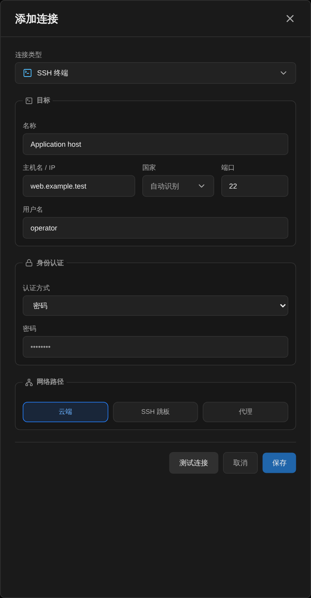

# MCP リモート管理ツールの選び方：Bastrio、SSH、データベース、Docker を比較

[Docs home / 文档首页](../../../README.md) · [Article index / 文章目录](README.md) · [All languages / 所有语言](../README.md)

Original / 原文: [https://bastr.io/ja/articles/mcp-remote-management-tools/](https://bastr.io/ja/articles/mcp-remote-management-tools/)

Languages / 语言: [English](../en/mcp-remote-management-tools.md) · [简体中文](../zh/mcp-remote-management-tools.md) · [繁體中文](../zh-TW/mcp-remote-management-tools.md) · [Español](../es/mcp-remote-management-tools.md) · [Deutsch](../de/mcp-remote-management-tools.md) · [Français](../fr/mcp-remote-management-tools.md) · [日本語](../ja/mcp-remote-management-tools.md) · [한국어](../ko/mcp-remote-management-tools.md) · [Bahasa Melayu](../ms/mcp-remote-management-tools.md) · [Русский](../ru/mcp-remote-management-tools.md)

> MCP が認可、人による承認、操作監査を通じて AI とリモートホストをどう接続するかを説明し、Bastrio MCP、SSH クライアント、データベース IDE、Docker ツール、RDP/VNC リモートデスクトップを比較します。

MCP（Model Context Protocol）は、AI クライアントが標準化されたツールを通じて管理対象のリモートリソースにアクセスできるようにします。これはサーバーパスワードを AI に渡すことではありません。サーバーが範囲のあるツールを公開し、利用者が影響の大きい操作を確認した上で、追跡可能な記録を残します。

資料確認日：2026 年 8 月 11 日。この記事は能力の境界と操作フローで比較しており、「MCP 対応」を自動的に安全であるかのようには書かず、統一条件を経ていない性能順位も使用しません。

## リモート管理における MCP の位置付け

Bastrio MCP は Streamable HTTP と API key を使用し、ツール一覧は認可 scope によりフィルタリングされます。AI クライアントはツールを探索し、ホストとワークスペースの情報を読み、ファイルを表示し、読み取り専用のデータベースクエリを実行できます。ファイル書き込み、端末コマンドの実行、データベース書き込み、ファイル転送、その他の影響の大きい操作は `approval_required` を返し、利用者がブラウザで確認した後にのみ実行されます。操作履歴はリクエストと結果を記録します。パスワード、秘密鍵、内部認証情報はツール出力として返されず、リソースは不透明ハンドル参照を使います。

## 一般的なツールとの能力比較

- **ツールまたは方法：** Bastrio MCP；**主な入口：** AI クライアント + ブラウザ承認；**AI オーケストレーション：** SSH、ファイル、データベース、Docker などをまたぐ作業；**人による承認と監査：** 影響の大きい操作を二重確認し記録を残す；**より適した場面：** リモート調査、制御された自動化、チーム協働
- **ツールまたは方法：** MobaXterm / Xshell / SecureCRT；**主な入口：** デスクトップ端末；**AI オーケストレーション：** ローカルスクリプトまたはクライアント統合に依存；**人による承認と監査：** チームの手順に依存；**より適した場面：** 端末、セッション、スクリプト、X11
- **ツールまたは方法：** DBeaver / DataGrip / Navicat；**主な入口：** デスクトップデータベース IDE；**AI オーケストレーション：** 一部製品には AI 支援がある；**人による承認と監査：** データベースとクライアント設定に依存；**より適した場面：** SQL 開発、モデリング、専門的分析
- **ツールまたは方法：** Portainer / Dockge / Docker Desktop；**主な入口：** Docker の Web またはデスクトップ画面；**AI オーケストレーション：** 製品統合による；**人による承認と監査：** デプロイとアカウント設定に依存；**より適した場面：** コンテナ、Compose、ローカル開発
- **ツールまたは方法：** Apache Guacamole / TeamViewer；**主な入口：** RDP/VNC またはリモート支援画面；**AI オーケストレーション：** 通常は MCP 運用の入口ではない；**人による承認と監査：** プラットフォームの監査能力に依存；**より適した場面：** グラフィカルデスクトップへのアクセスとリモート支援

## 安全な AI 運用フロー

1. MCP API key を作成し、必要な scope だけを与え、環境変数を通じて AI クライアントに渡します。
2. クライアントに `tools/list` を実行させ、実際に利用可能なツールを確認します。固定のツール数を前提にしません。
3. 最初に状態、ログ、読み取り専用クエリを要求します。AI に対象、範囲、想定される影響を説明させます。
4. 書き込み操作について `approval_required`、操作 ID、有効期限、承認ページを確認し、ブラウザで確認または取り消します。
5. 実行後に操作履歴を表示し、対象ホスト、ファイルパス、SQL 条件、コンテナ名を照合します。

## 参考資料

- [Bastrio MCP クライアントガイド](https://bastr.io/ja/articles/mcp-ai-server-operations/)
- [Model Context Protocol](https://modelcontextprotocol.io/)
- [OpenSSH](https://www.openssh.com/)
- [Docker ドキュメント](https://docs.docker.com/)
- [DBeaver](https://dbeaver.io/)
- [Portainer](https://www.portainer.io/)

続けて読む：[SSH ツールの推奨](ssh-tools-browser-workspace.md)；[Docker 可視化管理ツール](docker-management-tools-by-scenario.md)。

## FAQ

### MCP により AI が自動的にサーバーの root 権限を取得しますか？

いいえ。MCP scope、ワークスペースメンバーの権限、接続認証情報、対象ホストのアカウントが、実行できる範囲をともに制限します。

### AI には状態の読み取りだけをさせ、すぐに修復を実行させないのはなぜですか？

読み取り専用の診断はレビューしやすく、システム状態も変更しません。修復操作はサービス、データ、権限に影響する可能性があるため、先にパラメーターを確認し、ブラウザ承認を経るべきです。

### MCP は SSH、データベース、Docker の専用ツールを置き換えられますか？

MCP は制御されたオーケストレーション層と AI の入口に近く、すべての専門クライアントを置き換える必要はありません。複雑な SQL、グラフィカルな Docker 開発、X11、完全な RDP/VNC デスクトップには、なお専用ツールが必要な場合があります。

### Bastrio の MCP は通常の WebSSH と何が違いますか？

WebSSH は主にブラウザ端末を提供します。MCP は AI クライアントが複数の制御されたツールを探索・呼び出しできるようにし、影響の大きい操作を人による承認フローへ送ります。

## Related articles / 相关文章

- [ブラウザーで SSH を使う方法](https://bastr.io/ja/articles/online-ssh-in-browser/)
- [SSH Permission denied (publickey) の修正方法](https://bastr.io/ja/articles/ssh-permission-denied-publickey/)
- [WebSSH 向け Nginx WebSocket リバースプロキシ：設定とアーキテクチャ](https://bastr.io/ja/articles/nginx-websocket-webssh/)
