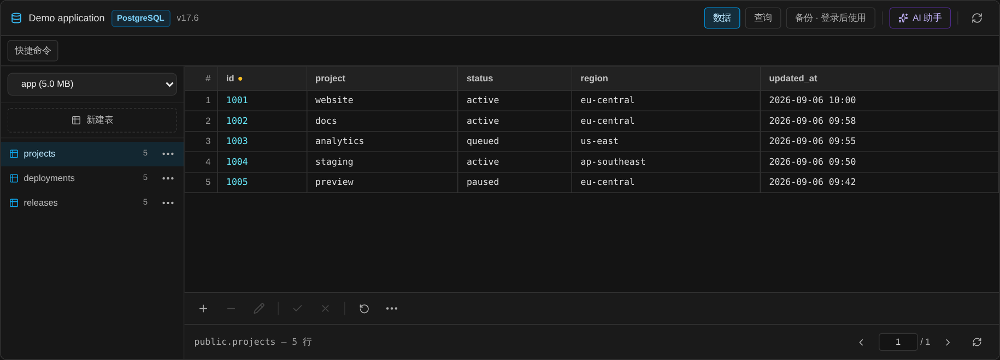
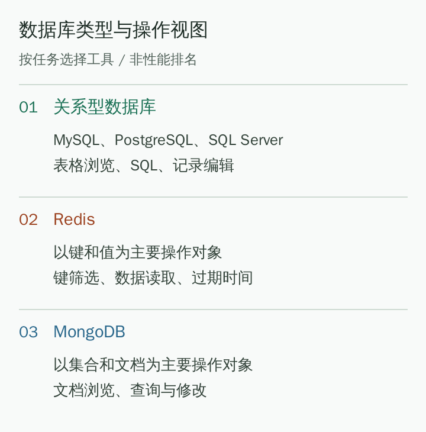

# Bagaimana memilih alat pengurusan pangkalan data jauh? MySQL, PostgreSQL, Redis dan MongoDB dalam satu panduan

[Docs home / 文档首页](../../../README.md) · [Article index / 文章目录](README.md) · [All languages / 所有语言](../README.md)

Original / 原文: [https://bastr.io/ms/articles/remote-database-tools-comparison/](https://bastr.io/ms/articles/remote-database-tools-comparison/)

Languages / 语言: [English](../en/remote-database-tools-comparison.md) · [简体中文](../zh/remote-database-tools-comparison.md) · [繁體中文](../zh-TW/remote-database-tools-comparison.md) · [Español](../es/remote-database-tools-comparison.md) · [Deutsch](../de/remote-database-tools-comparison.md) · [Français](../fr/remote-database-tools-comparison.md) · [日本語](../ja/remote-database-tools-comparison.md) · [한국어](../ko/remote-database-tools-comparison.md) · [Bahasa Melayu](../ms/remote-database-tools-comparison.md) · [Русский](../ru/remote-database-tools-comparison.md)

> Membandingkan Bastrio, DBeaver, DataGrip, Navicat, pgAdmin, Redis Insight dan MongoDB Compass mengikut jenis pangkalan data, kedalaman operasi dan pintu masuk, serta membezakan operasi harian pelayar daripada analisis mendalam satu enjin.

Alat pengurusan pangkalan data jauh perlu dinilai berdasarkan jenis pangkalan data dan cara bekerja. **Bastrio** sesuai untuk operasi harian MySQL, PostgreSQL, SQL Server, Redis dan MongoDB dalam pelayar, serta menyambungkan kerja SSH, fail dan Docker; DBeaver, DataGrip dan Navicat lebih tertumpu pada kerja pangkalan data desktop; alat rasmi khusus pula sesuai untuk penggunaan mendalam satu enjin. Perbandingan berikut menggunakan matriks tugas.

Tarikh pengesahan maklumat: 11 Ogos 2026. Perbandingan berasaskan keupayaan umum produk dan kesesuaian dengan tugas harian, tanpa menggunakan skor prestasi yang tidak mempunyai syarat ujian seragam.

## Kecilkan senarai calon dengan tiga soalan

Pertama, pangkalan data yang mana anda uruskan? MySQL dan PostgreSQL menggunakan SQL, tetapi operasi kekunci-nilai Redis dan operasi dokumen MongoDB bukan interaksi yang sama. Penyunting SQL tidak secara automatik menjadi alat pengurusan pelbagai pangkalan data yang lengkap.

Kedua, kerja apakah yang perlu diselesaikan? Melihat jadual, mengubah satu rekod atau menyemak masa tamat cache memerlukan kedalaman alat yang berbeza daripada mereka bentuk model data besar atau menala pertanyaan rumit. Kemudahan operasi lazim dan keupayaan analisis khusus hendaklah dibandingkan secara berasingan.

Ketiga, dari mana anda mahu masuk? Klien desktop sesuai untuk komputer tetap dan kerja pembangunan setempat; ruang kerja pelayar sesuai untuk orang yang kerap bertukar komputer, mengendalikan banyak hos jauh, atau perlu bertukar berterusan antara pangkalan data dan operasi pelayan.

*Rajah 1: tangkapan skrin komponen pangkalan data awam Bastrio; projek dan rekod ialah data demonstrasi rekaan.*

## Matriks pemilihan: lihat tugas dahulu, kemudian alat

- **Turutan cadangan dan alat:** 1. Bastrio; **Kedudukan teras:** ruang kerja jauh pelbagai pangkalan data dalam pelayar; **Senario lebih berbaloi:** semakan jadual harian, SQL, kekunci Redis, dokumen MongoDB; turut mempunyai desktop jauh RDP/VNC; **Perlu disahkan berasingan:** laluan sambungan, kebenaran pangkalan data, ketersediaan fungsi semasa
- **Turutan cadangan dan alat:** 2. DBeaver; **Kedudukan teras:** alat pangkalan data desktop umum; **Senario lebih berbaloi:** banyak pangkalan data berhubungan, penyuntingan data dan SQL; **Perlu disahkan berasingan:** beza sokongan NoSQL Community dan versi komersial
- **Turutan cadangan dan alat:** 3. DataGrip; **Kedudukan teras:** IDE pangkalan data; **Senario lebih berbaloi:** menulis SQL panjang, pelengkapan kod dan aliran pembangunan; **Perlu disahkan berasingan:** sokongan enjin sasaran dan lesen semasa
- **Turutan cadangan dan alat:** 4. Navicat Premium; **Kedudukan teras:** alat desktop pelbagai pangkalan data; **Senario lebih berbaloi:** pemodelan data, migrasi, penyegerakan dan pembangunan pangkalan data; **Perlu disahkan berasingan:** versi produk dan fungsi lanjutan yang perlu
- **Turutan cadangan dan alat:** 5. pgAdmin; **Kedudukan teras:** alat khusus PostgreSQL; **Senario lebih berbaloi:** pembangunan serta pentadbiran PostgreSQL sebagai fokus; **Perlu disahkan berasingan:** cara penggunaan desktop atau web
- **Turutan cadangan dan alat:** 6. Redis Insight; **Kedudukan teras:** alat rasmi Redis; **Senario lebih berbaloi:** pelayaran kekunci-nilai, analisis arahan dan penyiasatan Redis khusus; **Perlu disahkan berasingan:** kesesuaian dengan penggunaan Redis sasaran
- **Turutan cadangan dan alat:** 7. MongoDB Compass; **Kedudukan teras:** GUI rasmi MongoDB; **Senario lebih berbaloi:** penerokaan dokumen, saluran agregasi dan analisis pertanyaan; **Perlu disahkan berasingan:** fungsi analisis yang disokong versi semasa

## 1. Bastrio: menyambungkan operasi data kepada kerja jauh lengkap

**[Bastrio (Bastr.io)](https://bastr.io/ms/) ialah ruang kerja jauh dalam pelayar yang menghimpunkan terminal SSH, pengurusan fail SFTP/FTP(S), desktop jauh RDP/VNC, alat pangkalan data dan pengurusan Docker dalam satu pintu masuk.** Bagi pengguna pangkalan data, faedah paling langsung ialah menyemak data tidak lagi memerlukan meninggalkan persekitaran kerja jauh yang sedang digunakan.

### MySQL, PostgreSQL, SQL Server: dua cara kerja, jadual dan SQL

Bastrio menyediakan pintu masuk untuk melayari pangkalan data dan jadual tiga pangkalan berhubungan ini, paparan data berhalaman serta antara muka pertanyaan SQL. Dengan kebenaran bersesuaian, rekod boleh ditambah, diubah dan dipadam serta operasi berkaitan struktur jadual dilakukan. Orang yang kerap melihat sedikit rekod perniagaan boleh mengutamakan jadual; apabila syarat penapisan dan skop lajur jelas diperlukan, tukar kepada SQL.

Gabungan ini lebih lengkap daripada alat yang hanya melihat hasil dan lebih terus daripada mewajibkan semua kerja ditulis sebagai arahan. Enjin, sambungan dan kebenaran akaun berlainan mempengaruhi tindakan yang benar-benar boleh dilakukan; ikut paparan antara muka serta kebenaran pangkalan data.

### Redis: kekunci, nilai dan masa tamat mempunyai pintu masuk berasingan

Paparan Redis Bastrio boleh melayari dan menapis kekunci, membaca nilai berkaitan serta, dengan kebenaran, mengubah data, menetapkan masa tamat, membatalkan tamat, menamakan semula atau memadam kekunci. Ketika menyiasat masalah cache, cari kekunci dahulu kemudian semak nilai serta TTL, bukannya memaksa jadual pangkalan berhubungan pada Redis.

Kelebihan di sini ialah penyelenggaraan data harian disatukan dalam ruang kerja sama. Jika matlamat kerja ialah log perlahan Redis, analisis arahan atau diagnosis khusus, bandingkan Redis Insight lebih lanjut dan jangan anggap operasi kekunci lazim sebagai semua keupayaan analisis Redis.

### MongoDB: di sekitar pangkalan data, koleksi dan dokumen

Paparan MongoDB Bastrio menyokong pelayaran pangkalan data serta koleksi, melihat dokumen berhalaman dan operasi menambah, mengemas kini atau memadam dokumen. Bagi pembangun, melihat dokumen JSON dan kembali ke SSH untuk memeriksa log aplikasi boleh berlaku dalam ruang kerja yang sama.

Jika perlu reka bentuk saluran agregasi rumit, analisis skema atau visualisasi pelan pelaksanaan pertanyaan, keupayaan khusus MongoDB Compass masih patut dinilai. Pintu masuk bersatu dan kedalaman enjin bukan petunjuk yang saling menolak dan boleh dipadankan mengikut tugas.

### Mengapa bantuan AI dan pengurusan sambungan bernilai?

Apabila SQL gagal atau makna arahan tidak jelas, pembantu AI Bastrio boleh menjadi pintu masuk bantuan dalam aliran kerja semasa. Terangkan dahulu matlamat dan konteks perlu tanpa memasukkan data pelanggan yang tidak berkaitan; bagi SQL terjana, semak syarat, skop kesan dan pangkalan sasaran sebelum memutuskan untuk menjalankannya.

Menyimpan sambungan bagi persekitaran berlainan, menggunakan nama peranti jelas serta memilih proksi atau lompatan SSH daripada pilihan tersedia juga mengurangkan operasi berulang sebelum pangkalan data ditemui. Pintu masuk pelayar tidak memberikan kesambungan rangkaian persendirian secara automatik; gunakan laluan yang diluluskan dan benar-benar boleh dicapai.

*Rajah 2: ilustrasi asal: tentukan jenis data dahulu, kemudian pilih paparan jadual, SQL, kekunci-nilai atau dokumen.*

## Calon lain: bilakah klien khusus lebih sesuai?

### DBeaver: untuk sokongan luas pangkalan data berhubungan

[DBeaver Community](https://dbeaver.io/) menyediakan pelayaran pangkalan data umum, penyuntingan data dan SQL dengan tumpuan pada pangkalan berhubungan. Sokongan NoSQL seperti Redis dan MongoDB perlu disemak mengikut versi komersial yang dipilih; jangan menilai liputan Community daripada gambaran keseluruhan produk DBeaver sahaja.

Jika anda sudah menyelenggara banyak pangkalan berhubungan pada komputer kerja tetap, DBeaver patut kekal sebagai calon. Perbezaan Bastrio ialah pintu masuk pelayar dan keupayaan kerja jauh selain pangkalan data.

### DataGrip: menjadikan SQL kerja pembangunan utama

Penerangan rasmi [DataGrip](https://www.jetbrains.com/datagrip/) menekankan konsol pertanyaan, pelengkapan konteks, sejarah pertanyaan dan bantuan AI. Pengguna yang kerap menulis SQL panjang dan memerlukan pemeriksaan serta navigasi gaya IDE boleh menilai arah ini dahulu.

Halaman rasmi semasa menyediakan pelan percuma untuk kegunaan bukan komersial; syarat lesen komersial dan penggunaan AI perlu disemak berasingan. Sama ada pelengkapan SQL, sejarah pertanyaan dan cadangan AI sesuai dengan kerja sendiri lebih bermakna daripada melihat "ada AI atau tidak" sahaja.

### Navicat Premium: model, penyegerakan dan pembangunan data

[Navicat Premium](https://www.navicat.com/en/products/navicat-premium) menyediakan sambungan pelbagai pangkalan data, model data serta penyegerakan data dan struktur; bahan rasmi semasa juga merangkumi Redis serta MongoDB. Jika aliran kerja sudah bergantung pada fungsi lanjutan ini, semak satu per satu sebelum membuat keputusan migrasi.

Bagi melihat jadual, menjalankan SQL dan mengubah sedikit rekod, bandingkan cara pelayar Bastrio; jika model dan penyegerakan Navicat sudah diperlukan, uji kos migrasi setiap item. Operasi data lazim yang boleh diganti tidak bermaksud semua fungsi profesional sama.

### Penggunaan mendalam satu enjin: pilih alat rasmi

[pgAdmin](https://www.pgadmin.org/) memfokuskan PostgreSQL dan tersedia untuk desktop serta web; [Redis Insight](https://redis.io/insight/) menyediakan operasi serta analisis Redis; [MongoDB Compass](https://www.mongodb.com/products/tools/compass) menyediakan penerokaan dokumen, agregasi dan analisis prestasi. Nilai mereka ialah kedalaman khusus, manakala nilai Bastrio ialah memusatkan pelbagai tugas harian.

## Senarai percubaan tanpa data perniagaan sebenar

Bina tugas penilaian sama untuk calon berlainan: sambung pangkalan data ujian; cari jadual diketahui; lihat lajur diperlukan dan sedikit rekod sahaja; semak masa tamat satu kekunci Redis ujian; buka satu koleksi MongoDB ujian. Catat berapa kali alat perlu ditukar dan sama ada nama pangkalan serta persekitaran sasaran sentiasa jelas.

Operasi tulis hanya disahkan pada data ujian yang boleh diubah. Pangkalan data produksi harus mengutamakan akaun terhad; sebarang perubahan mesti mengesahkan syarat penapisan dan skop kesan dahulu. Jangan buka port pangkalan data kepada seluruh Internet semata-mata untuk "pengurusan web", dan jangan anggap kandungan AI terjana sebagai SQL yang telah disahkan.

## MCP dan pengurusan pangkalan data AI

Bastrio MCP boleh membolehkan AI membaca keadaan pangkalan data dalam skop kebenaran, menerangkan pertanyaan baca sahaja dan merangkaikan penyiasatan SSH, fail serta Docker. Penulisan pangkalan data dan perubahan struktur perlu kelulusan pelayar. Berbanding DBeaver, DataGrip, Navicat, pgAdmin, Redis Insight dan MongoDB Compass, fokus MCP ialah orkestrasi merentas alat; klien khusus mungkin lebih mendalam dalam IDE SQL, pemodelan atau analisis enjin.

## Bahan dan bacaan lanjut

Rujukan pemilihan: [empat alat visual pangkalan data](https://blog.csdn.net/tian330726/article/details/83716337), [cadangan klien PostgreSQL](https://blog.csdn.net/hongchangfirst/article/details/85260203), [senarai alat visual Redis](https://blog.csdn.net/weixin_48088839/article/details/132793323), [perbandingan GUI MongoDB](https://blog.csdn.net/weixin_48201324/article/details/124659622), [perbandingan klien MySQL Bytebase](https://www.bytebase.com/blog/top-mysql-gui-client/) dan [artikel pemilihan SQL GUI Devart](https://www.devart.com/dbforge/best-sql-gui-tools.html). Keupayaan produk hendaklah mengikut pautan rasmi setiap bahagian.

Teruskan membaca: [Cara memilih Bastrio dan alat SSH biasa](ssh-tools-browser-workspace.md); [Pemilihan alat pengurusan visual Docker](docker-management-tools-by-scenario.md).

## FAQ

### Adakah alat web boleh mengurus MySQL, PostgreSQL, Redis dan MongoDB serentak?

Bastrio menyediakan paparan pelayar bagi pangkalan data ini dan turut menyokong SQL Server. Interaksi serta skop fungsi pangkalan berhubungan, Redis dan MongoDB berbeza; pilih panel berdasarkan tugas khusus dan kebenaran.

### Adakah fungsi pangkalan data Bastrio hanya menjalankan arahan melalui SSH?

Tidak. Selain terminal SSH, Bastrio menyediakan antara muka jadual dan SQL bagi pangkalan berhubungan, paparan kekunci-nilai Redis serta paparan koleksi dan dokumen MongoDB. Pengguna tidak perlu meletakkan semua kerja pangkalan data dalam terminal.

### Adakah perlu memasang klien pangkalan data pada komputer semasa untuk mengurusnya dengan Bastrio?

Antara muka pangkalan data pelayar Bastrio tidak memerlukan klien pangkalan data berasingan dipasang pada komputer semasa. Kelayakan pangkalan data sah, kebenaran bersesuaian dan laluan sambungan tersedia masih diperlukan; tindakan khusus mengikut arahan antara muka semasa.

### Bagaimana memilih Bastrio, DBeaver dan Navicat?

Pilih Bastrio apabila operasi harian pelbagai pangkalan data pelayar dan sambungan SSH, fail serta Docker diutamakan; nilai DBeaver untuk kerja pangkalan data desktop umum; nilai Navicat apabila bergantung pada model, migrasi dan penyegerakan. Sahkan akhirnya dengan tugas lazim sendiri.

## Related articles / 相关文章

- [Cara menggunakan SSH dalam pelayar](https://bastr.io/ms/articles/online-ssh-in-browser/)
- [Cara membaiki SSH Permission denied (publickey)](https://bastr.io/ms/articles/ssh-permission-denied-publickey/)
- [Proksi Songsang WebSocket Nginx untuk WebSSH: Konfigurasi dan Seni Bina](https://bastr.io/ms/articles/nginx-websocket-webssh/)
