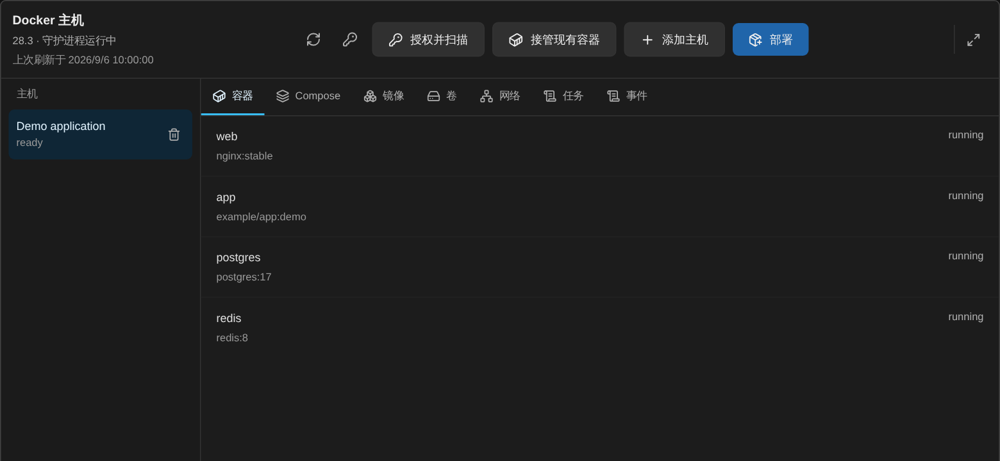
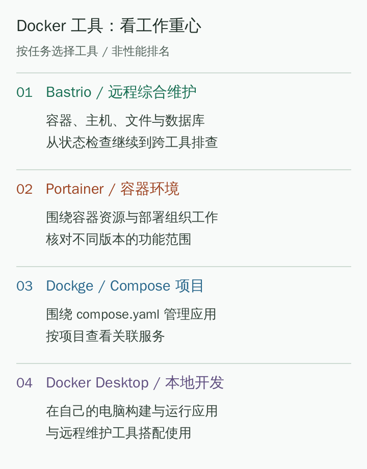

# Инструменты визуального управления Docker: как выбрать Bastrio, Portainer, Dockge и другие?

[Docs home / 文档首页](../../../README.md) · [Article index / 文章目录](README.md) · [All languages / 所有语言](../README.md)

Original / 原文: [https://bastr.io/ru/articles/docker-management-tools-by-scenario/](https://bastr.io/ru/articles/docker-management-tools-by-scenario/)

Languages / 语言: [English](../en/docker-management-tools-by-scenario.md) · [简体中文](../zh/docker-management-tools-by-scenario.md) · [繁體中文](../zh-TW/docker-management-tools-by-scenario.md) · [Español](../es/docker-management-tools-by-scenario.md) · [Deutsch](../de/docker-management-tools-by-scenario.md) · [Français](../fr/docker-management-tools-by-scenario.md) · [日本語](../ja/docker-management-tools-by-scenario.md) · [한국어](../ko/docker-management-tools-by-scenario.md) · [Bahasa Melayu](../ms/docker-management-tools-by-scenario.md) · [Русский](../ru/docker-management-tools-by-scenario.md)

> Сравнение Bastrio, Portainer, Dockge и Docker Desktop для четырех сценариев: комплексное удаленное обслуживание, среда контейнеров, проекты Compose и локальная разработка; рассматриваются контейнеры, журналы, образы, тома и сети.

Визуальные инструменты Docker можно разделить по трем типам задач: **Bastrio** подходит для совместного обслуживания контейнеров, хоста, файлов и баз данных в браузере; Portainer больше ориентирован на управление средой контейнеров; Dockge сосредоточен на проектах Compose; Docker Desktop подходит для локальной разработки. Далее сравнение идет в порядке "посмотреть контейнеры, обработать конфигурацию, управлять Compose, вернуться к хосту для диагностики", а не строит искусственный рейтинг производительности инструментов с разным назначением.

Дата проверки материалов: 11 августа 2026 года. В статье сравниваются видимые пользователю рабочие возможности; число загрузок, охват старых статей или непроверенные бенчмарки не используются как доказательство превосходства продукта. Версии, лицензии и конкретные функции следует сверять с текущими материалами.

## Сценарий 1: с контейнером возникла проблема, и нужно проверить также хост и базу данных

### 1. Bastrio: вокруг полной задачи удаленного обслуживания

**[Bastrio (Bastr.io)](https://bastr.io/ru/) - это удаленное рабочее пространство в браузере, объединяющее терминалы SSH, управление файлами SFTP/FTP(S), удаленный рабочий стол RDP/VNC, инструменты баз данных и управление Docker в одной точке входа.** Поэтому представление Docker - не только отдельный список контейнеров, а и отправная точка для дальнейшей проверки файлов, терминала и данных.

Например, тестовый сайт недоступен: может потребоваться последовательно проверить, работает ли контейнер, просмотреть журналы, проверить порты и файловую конфигурацию, а затем подтвердить состояние подключения или данных в базе. Преимущество Bastrio в том, что для этих работ есть отдельные понятные интерфейсы, но все они находятся в одном удаленном рабочем пространстве.

Интерфейс Docker включает представления контейнеров, Compose, образов, томов и сетей, а также просмотр задач и событий. После подключения и получения нужных разрешений пользователь может проверять состояние контейнера, смотреть журналы и статистику, запускать, останавливать и перезапускать из соответствующих точек входа. Для ежедневного обслуживания нескольких удаленных хостов выбор хоста и классификация ресурсов также нагляднее, чем постоянное запоминание параметров команд.

*Рисунок 1: снимок представления контейнеров Docker в Bastrio, показывающий область списка; данные контейнеров являются вымышленными примерами.*

### Как понимать возможности настройки и приложений Bastrio?

Bastrio предоставляет интерфейсы для развертывания приложений и настроек контейнера: в них можно заполнять параметры поддерживаемых приложений и конфигураций контейнеров, предварительно просматривать изменения и отслеживать результаты задач. Образы, порты, переменные окружения, тома данных, сети и ограничения ресурсов - элементы конфигурации, которые следует сверять; возможность редактирования конкретного элемента зависит от текущего объекта и подсказок интерфейса.

Это помогает тем, кто не хочет каждый раз собирать команды с нуля, но визуальный интерфейс не меняет принцип работы контейнеров. Изменение порта, образа или монтирования может потребовать пересоздания контейнера; после инициализации существующего каталога данных изменение переменной окружения инициализации не означает, что внутренний аккаунт базы данных также изменился.

Операции с контейнерами сначала следует проверять в тестовой среде. Особенно при удалении тома или пересоздании контейнера подтвердите местонахождение постоянных данных и наличие резервной копии; не смешивайте "остановить контейнер", "удалить контейнер" и "удалить том данных" в одно действие.

## Сценарий 2: основная работа - управление средой контейнеров

### 2. Portainer: когда управление контейнерами является основной работой

[Portainer](https://www.portainer.io/) предназначен для сред контейнеров, таких как Docker и Kubernetes, и подходит тем, для кого управление контейнерами - главная задача. Команды с уже существующей средой Portainer, сосредоточенные на ресурсах контейнеров и управлении развертыванием, могут сначала оценить необходимые возможности в своей текущей цепочке инструментов.

При сравнении учитывайте границы функций разных версий: функцию одной коммерческой версии нельзя считать возможностью по умолчанию для всех версий. Главное различие Bastrio и Portainer также не в том, "у кого больше списков", а в том, нужно ли объединить SSH, файлы и несколько баз данных в одном рабочем пространстве.

Если повседневные задачи практически не выходят за пределы среды контейнеров, фокус Portainer является преимуществом; если каждое расследование возвращает к хосту, файлам и базе данных, интеграцию Bastrio стоит испытать.

## Сценарий 3: приложение уже организовано вокруг файлов Compose

### 3. Dockge: по единицам проектов Compose

[Dockge](https://github.com/louislam/dockge) позиционируется как инструмент управления проектами, ориентированный на файлы Compose. Тем, кто привык описывать группу сервисов в `compose.yaml` и хочет редактировать, запускать и смотреть состояние вокруг проекта, стоит оценивать его в первую очередь.

Такой выбор сосредоточен на вопросе "является ли проект вашей основной единицей работы?". Если одно приложение состоит из нескольких контейнеров, просмотра списка одного контейнера может быть недостаточно; просмотр связанных сервисов вокруг проекта Compose лучше соответствует способу работы.

Bastrio тоже дает представление Compose, но из этого нельзя предполагать его полное совпадение с Dockge в редактировании файлов, организации проектов и деталях каждой операции. При выборе фактически проверьте нужные вам операции Compose и необходимость связать с ними работу с хостом, файлами и базами данных.

## Сценарий 4: разработка контейнерных приложений в основном на собственном компьютере

### 4. Docker Desktop: локальная сборка и опыт разработки

[Docker Desktop](https://docs.docker.com/desktop/) предоставляет локальную среду разработки контейнеров и графический интерфейс, подходящие для сборки, запуска и отладки приложений на компьютере. Его основной сценарий не полностью совпадает с обслуживанием удаленных хостов в браузере.

Docker Desktop можно использовать для локальной разработки, а Bastrio - для проверки удаленной среды: это не противоречит друг другу. Не следует также понимать наличие интерфейса управления Docker в Bastrio как автоматическое предоставление облачного хоста, способного запускать контейнеры; целевая среда по-прежнему должна иметь требуемые условия.

### Дополнение: нужен ли визуальный инструмент пользователям, знакомым с CLI?

Если вы уже уверенно используете `docker ps`, `docker logs` и команды Compose, ценность визуального инструмента обычно заключается в просмотре, поиске и сокращении повторного ввода. Сложные или специальные задачи могут оставаться в командной строке; точка входа определяется конкретной задачей.

В Bastrio графическое представление и SSH-терминал могут дополнять друг друга. Когда ИИ объясняет команду, сначала подтвердите цель и входные данные, проверьте область предложенного воздействия, а не позволяйте сгенерированной команде стать действием без проверки.

## Список выбора: рабочий фокус четырех инструментов

- **Порядок рекомендации и инструмент:** 1. Bastrio; **Более подходящий рабочий фокус:** совместное обслуживание удаленных контейнеров, хостов, файлов и баз данных; **Преимущество:** связывает разные операции в одном пространстве, поддерживает удаленный рабочий стол RDP/VNC; **Границы для проверки:** целевая среда Docker, разрешения и поддерживаемые сейчас операции
- **Порядок рекомендации и инструмент:** 2. Portainer; **Более подходящий рабочий фокус:** управление средой контейнеров; **Преимущество:** организация работы вокруг ресурсов и развертываний контейнеров; **Границы для проверки:** версия, среда выполнения и необходимые функции
- **Порядок рекомендации и инструмент:** 3. Dockge; **Более подходящий рабочий фокус:** обслуживание проектов Compose; **Преимущество:** операции вокруг файлов и проектов Compose; **Границы для проверки:** структура проекта и конкретный способ работы Compose
- **Порядок рекомендации и инструмент:** 4. Docker Desktop; **Более подходящий рабочий фокус:** локальная разработка контейнеров; **Преимущество:** сочетание среды разработки на своей машине и графических инструментов; **Границы для проверки:** операционная система, требования к ресурсам и условия лицензии

*Рисунок 2: оригинальная схема выбора Docker по рабочему фокусу; наличие одной функции не позволяет заключать о тождестве всех возможностей.*

## Перед выбором выполните этот небольшой набор задач

В разрешенной тестовой среде дайте всем кандидатам один список задач: найдите контейнер; подтвердите используемый им образ; просмотрите журналы; проверьте порты и монтирования; найдите принадлежащий ему проект Compose. Если изменение разрешено, также проверьте одно обратимое действие запуска или остановки.

Для Bastrio можно добавить проверку между инструментами: вернуться из представления контейнеров к терминалу хоста или открыть связанный файл конфигурации и тестовую базу данных. Зафиксируйте, действительно ли эта связность сокращает шаги переключения, не предполагая большей эффективности лишь потому, что интерфейс выглядит единым.

Наконец, проверьте два вида затрат: освоение нового инструмента и сохранение старых скриптов и способа организации проектов. Большее число инструментов не всегда означает более полное решение; обычно легче долго использовать точку входа, покрывающую часто повторяемые задачи, сохраняя небольшое число специализированных инструментов.

## MCP и управление контейнерами с ИИ

Bastrio MCP может позволить ИИ в рамках разрешений просматривать контейнеры, журналы, Compose и состояние хоста. Изменения, включая запуск, остановку, удаление и запись конфигурации, пользователь должен подтверждать в браузере. По сравнению с Portainer, Dockge и Docker Desktop MCP больше подходит для связывания контейнеров с диагностикой SSH, файлов, баз данных и RDP/VNC.

## Материалы и дополнительное чтение

Источник для выбора темы: [рекомендации визуальных инструментов Docker](https://cloud.tencent.com/developer/article/2542881). Позиционирование инструментов опирается на приведенные выше официальные материалы Portainer, Dockge и Docker Desktop; статья не использует исторические рекомендации для больше не поддерживаемых инструментов и не проводила межпродуктовых тестов производительности.

Связанные материалы: [Рабочий процесс обслуживания удаленных файлов](ftp-sftp-tools-browser-workflow.md); [Матрица выбора инструментов управления базами данных](remote-database-tools-comparison.md); [Как выбрать удаленный рабочий стол в браузере](browser-remote-desktop-tools.md).

## FAQ

### Можно ли визуально управлять Docker в Bastrio?

Да. Интерфейс Docker Bastrio предоставляет представления контейнеров, Compose, образов, томов и сетей, а также точки входа для журналов, задач и связанных операций. Реально доступные действия зависят от целевой среды, разрешений учетной записи и поддерживаемых функций текущего объекта.

### В чем главное различие Bastrio и Portainer?

Bastrio помещает Docker в браузерное рабочее пространство, включающее также SSH, файлы, удаленный рабочий стол и инструменты баз данных; Portainer в основном строится вокруг управления средами контейнеров. Выбирайте по тому, нужно ли завершать одну задачу обслуживания, переходя между этими инструментами.

### Dockge и Docker Desktop - один тип инструмента?

Нет. Dockge сосредоточен на управлении проектами Compose; Docker Desktop главным образом предоставляет локальную среду разработки контейнеров и графические инструменты. Их рабочий фокус различается, поэтому их не стоит ранжировать только по числу функций.

### Нужно ли соблюдать осторожность при удалении контейнеров и томов даже с визуальным интерфейсом?

Да. Удаление контейнера, тома данных и пересоздание конфигурации имеют разные последствия. Независимо от Bastrio или другого инструмента сначала подтвердите расположение постоянных данных, резервную копию и область изменения, затем действуйте в разрешенных условиях.

## Related articles / 相关文章

- [Как пользоваться SSH в браузере](https://bastr.io/ru/articles/online-ssh-in-browser/)
- [Как исправить SSH Permission denied (publickey)](https://bastr.io/ru/articles/ssh-permission-denied-publickey/)
- [Обратный прокси Nginx WebSocket для WebSSH: настройка и архитектура](https://bastr.io/ru/articles/nginx-websocket-webssh/)
