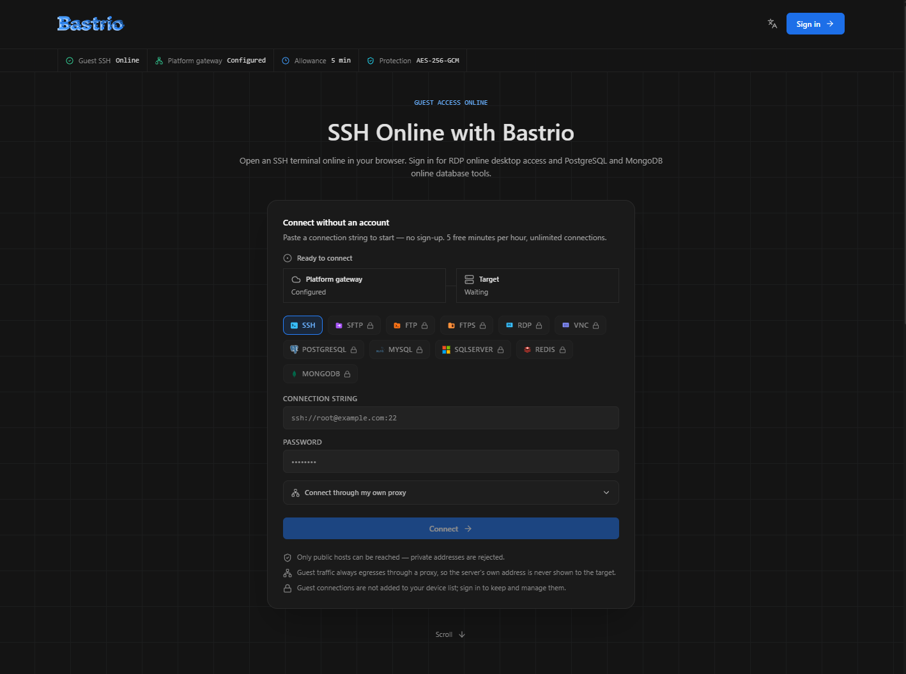
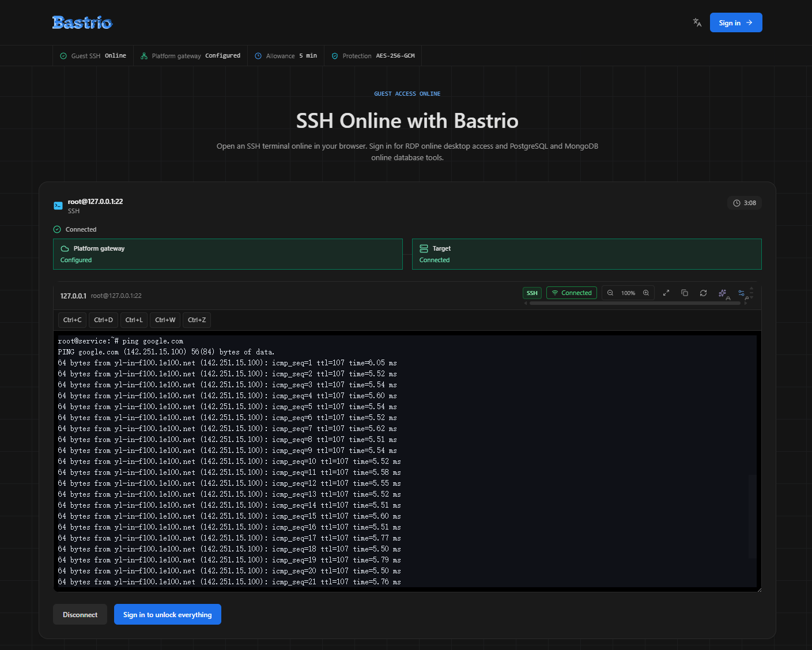
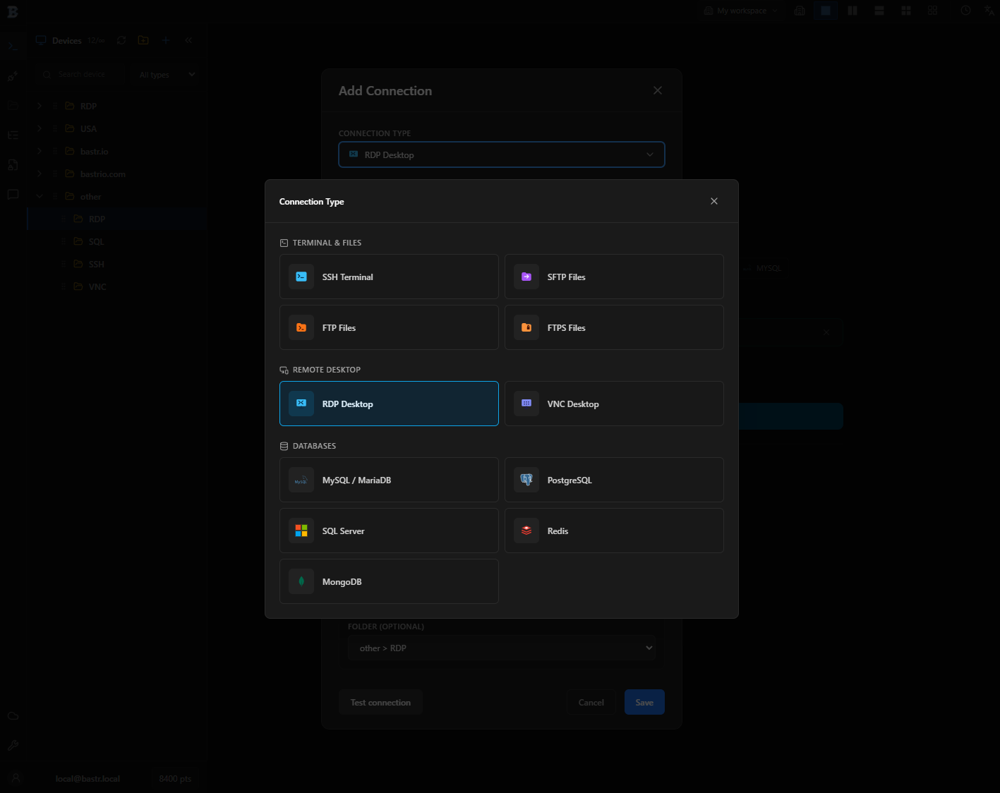
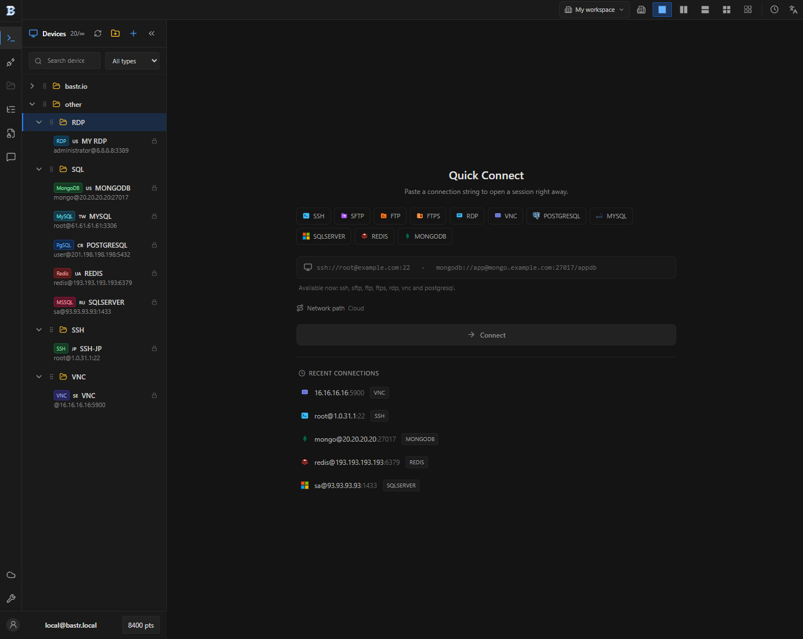
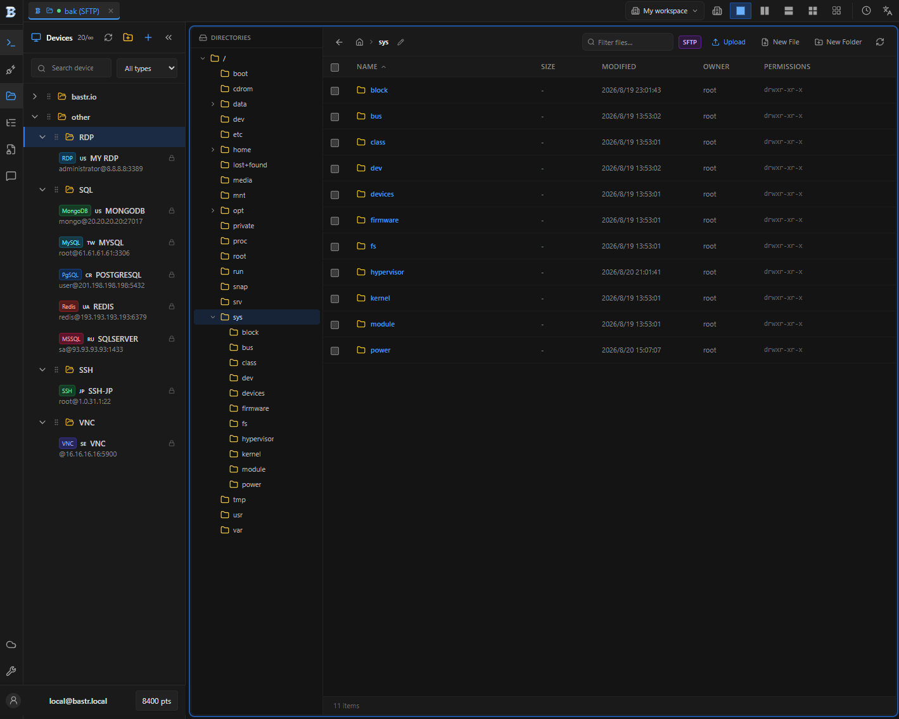
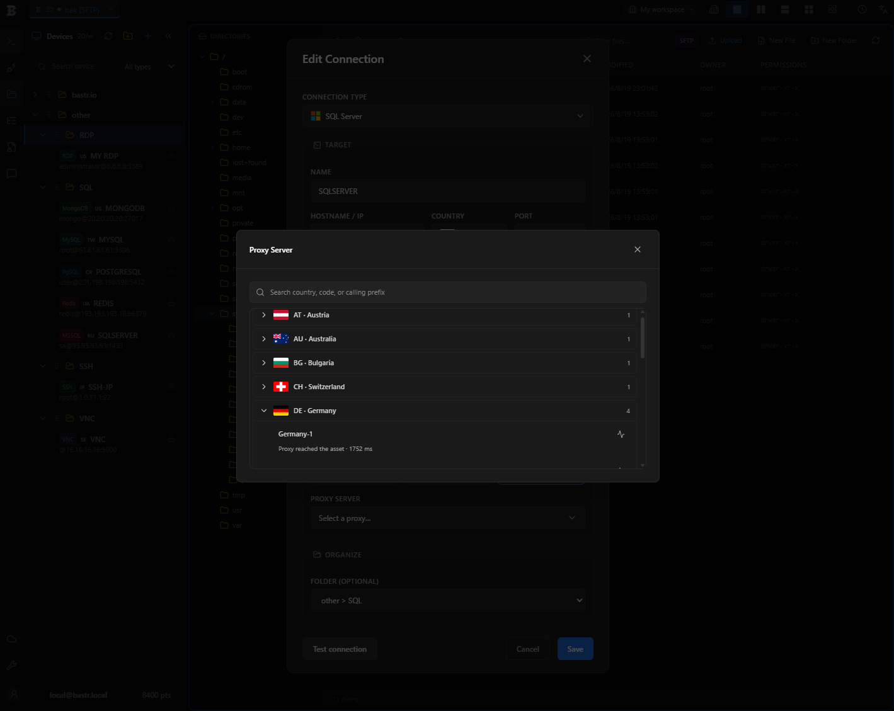
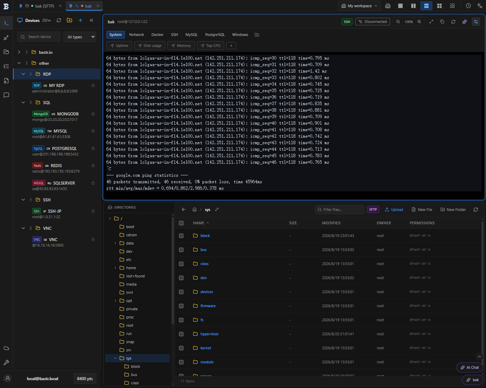
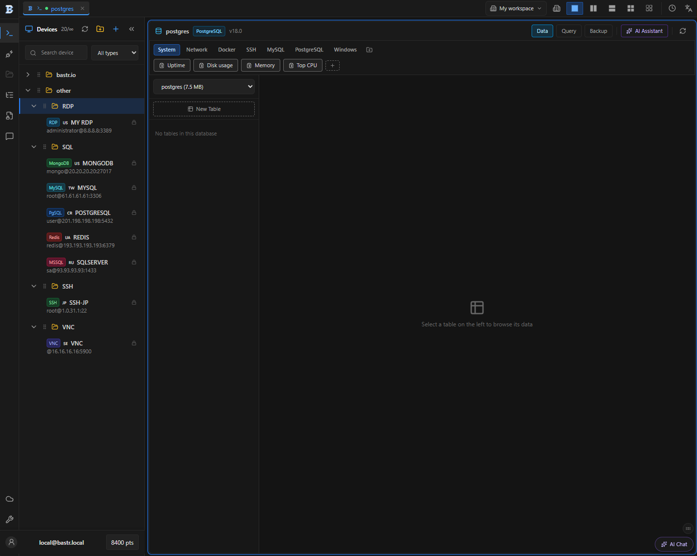
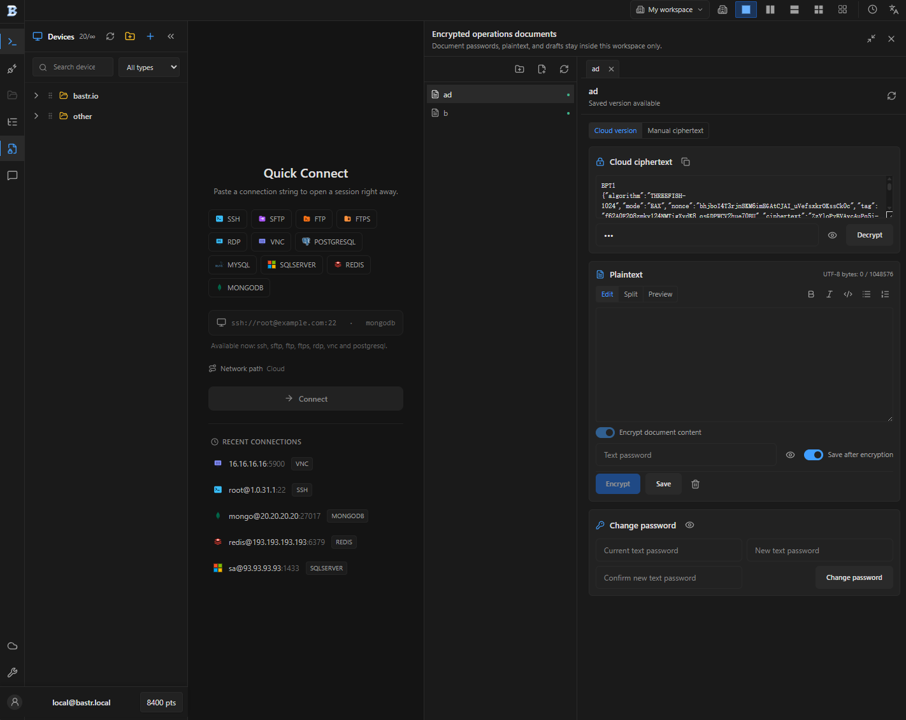
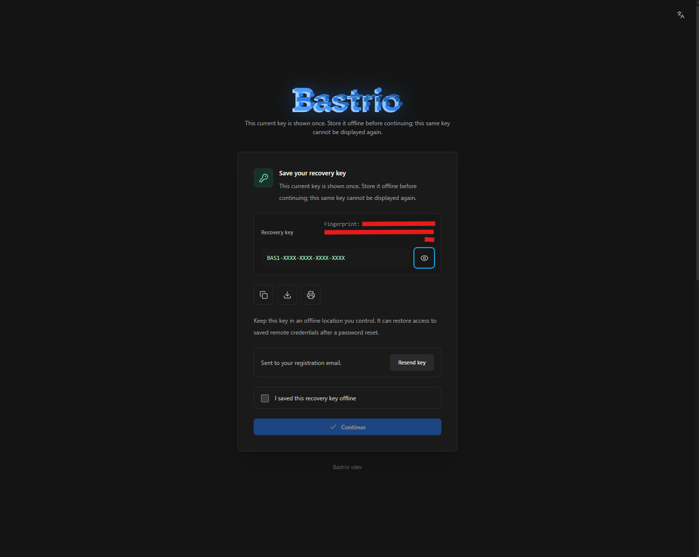

Um espaço de trabalho no navegador para acesso remoto seguro, operações de infraestrutura e colaboração.

<a href="https://bastr.io/"><strong>bastr.io</strong></a> &nbsp;|&nbsp; 

<a href="../../README.md">English</a> | <a href="README.zh-CN.md">简体中文</a> | <a href="README.zh-TW.md">繁體中文</a> | <a href="README.ja.md">日本語</a> | <a href="README.ko.md">한국어</a> | <a href="README.es.md">Español</a> | <a href="README.de.md">Deutsch</a> | <a href="README.fr.md">Français</a> | <strong>Português</strong> | <a href="README.ar.md">العربية</a>

## Um espaço de trabalho para infraestrutura remota

[Bastrio](https://bastr.io/) reúne **SSH online**, SFTP, FTP/FTPS, RDP, VNC e conexões de banco de dados em um único espaço de trabalho no navegador. Use-o como terminal web SSH, gerenciador de arquivos online, cliente de banco de dados no navegador ou espaço compartilhado para administrar servidores remotos.

## Recursos principais

- **Conecte-se pelo navegador:** terminal SSH online, arquivos via SFTP/FTP/FTPS e desktops remotos RDP e VNC.
- **Ferramentas de banco de dados unificadas:** PostgreSQL, MySQL/MariaDB, SQL Server, Redis e MongoDB no mesmo espaço de trabalho.
- **Organize conexões:** conexões salvas, pastas, filtros por tipo, recentes, várias sessões e layouts divididos.
- **Escolha o caminho de rede:** proxy IP por região, proxy personalizado ou host de salto SSH para infraestrutura não exposta diretamente.
- **Assistência de IA:** o assistente de IA ajuda a explicar saídas, elaborar comandos e apoiar tarefas de terminal e banco de dados.
- **Espaços colaborativos:** espaços de trabalho e recursos compartilhados preservam o contexto de conexão da equipe.
- **Documentos operacionais criptografados:** escreva, criptografe e guarde notas, rascunhos e texto sensível dentro do espaço de trabalho.

 

 

 

 

## Caminhos de rede sob seu controle

O Bastrio permite usar o caminho adequado para cada acesso remoto no navegador: selecione um **proxy IP** para uma região de saída, configure um proxy personalizado para controlar a rota ou use um **host de salto SSH** para alcançar infraestrutura privada. Essas opções ficam na própria configuração da conexão.

## Trabalho remoto concentrado e colaborativo

Bastrio é um espaço remoto para desenvolvedores, operadores e equipes que alternam entre servidores, arquivos, desktops e bancos de dados. Espaços de trabalho e recursos compartilhados preservam o contexto; várias sessões e layouts divididos mantêm o trabalho relacionado visível; o assistente de IA fica próximo da tarefa.

## Privacidade por design

Credenciais e conteúdo privado do espaço de trabalho são criptografados em trânsito e em repouso. O Bastrio só descriptografa credenciais temporariamente na memória volátil do servidor quando uma operação autorizada as exige; texto simples nunca é gravado em disco ou logs. Todo acesso visível ao usuário exige uma sessão autenticada válida. Quando uma sessão expira ou é revogada, não é mais possível acessar ou descriptografar o cofre criptografado. A chave de recuperação é exibida apenas uma vez; ela é necessária para restaurar credenciais criptografadas após uma redefinição de senha. Sem ela, o cofre criptografado não pode ser recuperado ou exportado em formato legível.

## Marketplace, planejado

Bastrio está preparando um Marketplace para servidores gerenciados e serviços de proxy IP. Essas ofertas estão planejadas para uma versão futura e não estão disponíveis no momento.

## Começar

1. Visite [bastr.io](https://bastr.io/) para abrir o espaço remoto Bastrio.
2. Escolha SSH, transferência de arquivos, desktop remoto ou uma conexão de banco de dados.
3. Se necessário, escolha um caminho de rede e salve a conexão para organizar o trabalho futuro.

## Perguntas frequentes

### Bastrio é um terminal web SSH?

Sim. Bastrio oferece SSH online no navegador junto com transferência de arquivos, desktop remoto, bancos de dados, proxy e ferramentas de espaço de trabalho.

### Posso usar proxy IP, proxy personalizado e host de salto SSH?

Sim. Bastrio oferece seleção regional de proxy IP, configuração de proxy personalizado e hosts de salto SSH.

### Uma equipe pode colaborar no mesmo ambiente?

Sim. Espaços de trabalho e recursos compartilhados são projetados para manter o trabalho de infraestrutura remota organizado e colaborativo.

## Contribuições

Contribuições e relatos de problemas são bem-vindos. Mantenha as propostas focadas no comportamento visível para o usuário e não inclua credenciais ou dados privados de conexão em issues ou pull requests.

## Licença

Bastrio é publicado sob a [GNU General Public License v3.0](https://www.gnu.org/licenses/gpl-3.0.html).
